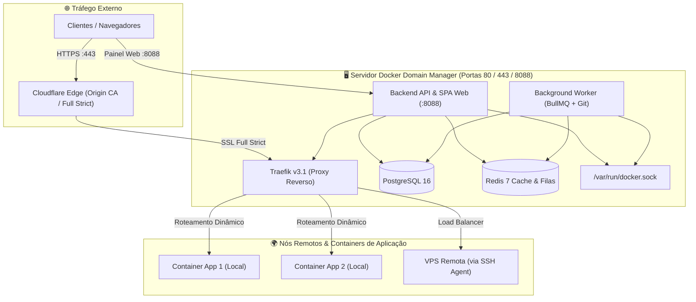

# 🚀 Docker Domain Manager

<div align="center">


### Orquestrador Moderno de Containers, Proxy Reverso Traefik v3 e Load Balancing Multi-Host

[](https://github.com/vcmuniz/docker-domain/releases)
[](https://www.docker.com/)
[](https://traefik.io/)
[](https://www.typescriptlang.org/)
[](https://opensource.org/licenses/MIT)

<p align="center">
  <a href="#-instalação-rápida-em-1-comando">Instalação Rápida</a> •
  <a href="#-recursos-principais">Recursos</a> •
  <a href="#-arquitetura-do-sistema">Arquitetura</a> •
  <a href="#-primeiros-passos--credenciais">Acesso Inicial</a> •
  <a href="#-atualização-do-sistema">Atualização</a> •
  <a href="#-suporte-e-contribuição">Contribuição</a>
</p>

</div>

---

## 💡 O que é o Docker Domain Manager?

O **Docker Domain Manager** é uma plataforma PaaS *self-hosted* projetada para simplificar a gestão de microsserviços, roteamento de múltiplos domínios e alta disponibilidade de containers Docker.

Com ele, você transforma qualquer VPS Linux ou servidor bare-metal em um ambiente de produção robusto, com **Traefik v3.1 integrado**, suporte nativo a **Cloudflare SSL Full (Strict)**, balanceamento de carga entre múltiplos nós remotos via SSH, deploys automatizados via Git Webhooks e uma interface gráfica moderna e fluida.

---

## ⚡ Instalação Rápida em 1 Comando

O instalador oficial detecta sua distribuição Linux, instala e valida o Docker e Docker Compose, gera chaves criptográficas exclusivas e coloca toda a stack no ar em menos de 2 minutos.

### 🐧 Linux VPS (Ubuntu / Debian / CentOS / AlmaLinux / Rocky)

Execute diretamente no terminal do seu servidor como `root` (ou com `sudo`):

```bash
curl -fsSL https://raw.githubusercontent.com/vcmuniz/docker-domain/master/scripts/install.sh | bash
```

---

### 💻 Windows (PowerShell com Docker Desktop)

Abra o PowerShell como Administrador e execute:

```powershell
irm https://raw.githubusercontent.com/vcmuniz/docker-domain/master/scripts/install.ps1 | iex
```

---

### 🐳 Instalação Manual com Docker Compose

Caso prefira gerenciar você mesmo seu arquivo de configuração:

```bash
# 1. Crie a pasta da aplicação
mkdir -p /opt/docker-domain && cd /opt/docker-domain

# 2. Baixe o docker-compose de produção
curl -fsSL https://raw.githubusercontent.com/vcmuniz/docker-domain/master/docker-compose.prod.yml -o docker-compose.yml

# 3. Crie seu .env com senhas seguras
cat <<EOF > .env
POSTGRES_USER=postgres
POSTGRES_PASSWORD=$(openssl rand -hex 16)
POSTGRES_DB=domainmanager
JWT_SECRET=$(openssl rand -hex 32)
PORT=8088
APP_VERSION=v0.1.0
EOF

# 4. Inicie os containers oficiais
docker compose up -d
```

---

## 🔑 Primeiros Passos & Credenciais Padrão

Assim que o script concluir a instalação, acesse o painel pelo navegador:

| Parâmetro | Valor Padrão |
| :--- | :--- |
| **URL de Acesso** | `http://SEU_IP_OU_DOMINIO:8088` |
| **E-mail do Administrador** | `admin@bla.com.br` |
| **Senha Temporária** | `admin123` |
| **Portas em Uso** | `80` (HTTP), `443` (HTTPS Traefik), `8088` (Painel Web) |

> [!IMPORTANT]
> **Segurança:** Altere imediatamente a senha inicial e o e-mail após o primeiro login navegando em **Configurações do Sistema**.

---

## ✨ Recursos Principais

- 🌐 **Roteamento Dinâmico sem Reinicialização:** Crie, altere e aponte múltiplos domínios e subdomínios para qualquer container instantaneamente usando o file provider do Traefik v3.
- ⚖️ **Load Balancing & Multi-Host Avançado:** Distribua requisições entre réplicas locais ou servidores remotos conectados via SSH seguro. Suporte a algoritmos **Round-Robin**, **Ponderado (Weight)** e **Failover Ativo** com checagem de saúde contínua.
- 🔒 **Terminação SSL Cloudflare Full (Strict):** Compatibilidade total com certificados Origin CA da Cloudflare, permitindo túneis TLS ponta a ponta criptografados sem falhas de verificação de autoridade.
- 🎯 **Fallback Catch-All Inteligente:** Defina um serviço de contingência global para capturar requisições de domínios desconhecidos ou subdomínios órfãos.
- 📦 **Git Deploy Automatizado:** Conecte seus repositórios GitHub / GitLab via Webhooks. O background worker clona, compila e sobe os novos containers sem interromper o tráfego existente.
- 🔄 **Atualização com 1 Clique (Zero Downtime):** Notificação em tempo real de novas versões lançadas no GitHub, com botão de auto-atualização direta no painel web ou via script de linha de comando.
- 📊 **Monitoramento em Tempo Real:** Acompanhe consumo de CPU, Memória, conexões ativas e logs de containers diretamente pela interface web sem precisar abrir o terminal SSH.
- 🛡️ **Auditoria Completa (Audit Logs):** Rastreamento de todas as ações administrativas (criação de serviços, deploys, alteração de DNS, autenticações) salvas no PostgreSQL 16.

---

## 🏗️ Arquitetura do Sistema



---

## 🔄 Atualização do Sistema

Quando uma nova versão do **Docker Domain Manager** for publicada, você pode atualizá-la de duas formas:

### Opção 1: Diretamente pela Interface Web (Recomendado)
1. Acesse o painel web no menu **Configurações**.
2. No card **"Versão & Atualizações do Sistema"**, caso haja um release novo, clique em **"Atualizar Sistema Agora"**.
3. A stack baixará as novas imagens do GHCR e reiniciará suavemente em segundo plano.

### Opção 2: Pelo Terminal do Servidor (CLI)
```bash
cd /opt/docker-domain
./update.sh
```

---

## 📋 Pré-requisitos de Sistema

- **Sistema Operacional:** Linux x86_64 / arm64 (Ubuntu 20.04+, Debian 11+, CentOS 8+, AlmaLinux, Rocky) ou Windows 10/11 com Docker Desktop.
- **Hardware Mínimo:** 1 vCPU, 1 GB de memória RAM livre, 10 GB de disco.
- **Hardware Recomendado:** 2 vCPUs, 2 GB de RAM ou superior para compilação simultânea de projetos Git.
- **Portas Liberadas no Firewall:**
  - `80/TCP`: HTTP (redirecionado automaticamente para HTTPS pelo Traefik)
  - `443/TCP`: HTTPS (tráfego seguro de aplicações)
  - `8088/TCP`: Interface Administrativa do Docker Domain Manager

---

## 🛠️ Tecnologias Empregadas

- **Linguagem & Runtime:** Node.js 22 LTS, TypeScript 5.6
- **Monorepo Manager:** pnpm 9 workspaces
- **Frontend SPA:** React 19, Tailwind CSS, Lucide Icons, Vite
- **Backend API:** Express, Dockerode, BullMQ, JSON Web Tokens
- **Banco de Dados & ORM:** PostgreSQL 16, Prisma ORM
- **Proxy Reverso:** Traefik v3.1 File Provider & Dynamic Routing
- **Contêineres & Distribuição:** Docker, Docker Compose, GitHub Container Registry (GHCR)

---

## 📄 Licença

Este projeto é distribuído sob a licença [MIT](LICENSE). Você é livre para utilizar, modificar e distribuir comercialmente ou em projetos pessoais.
