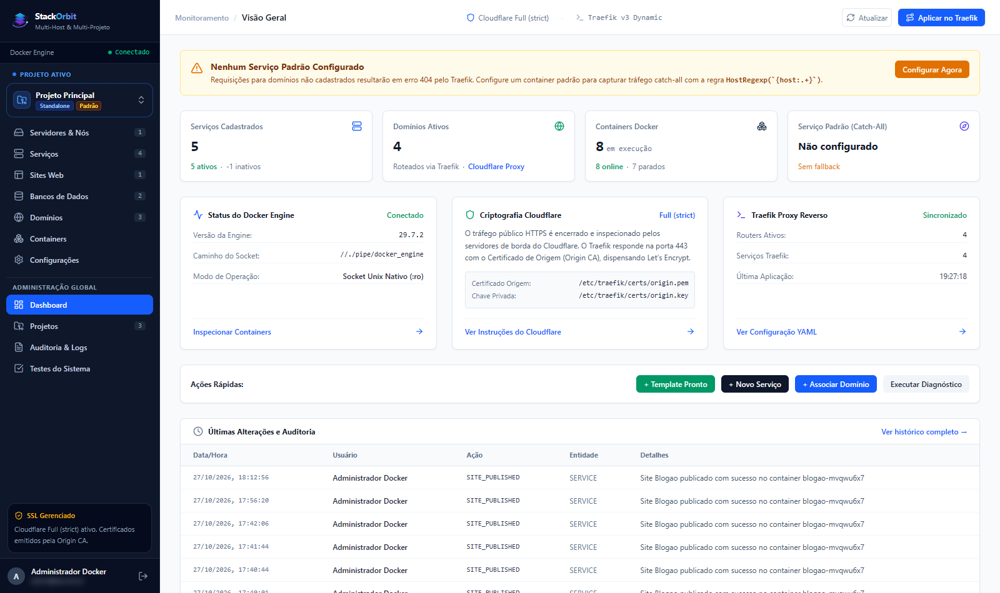
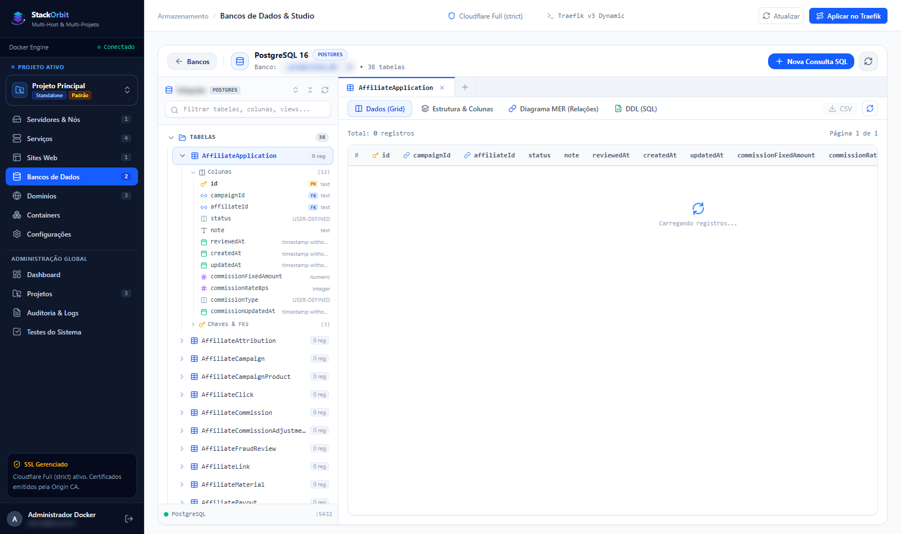
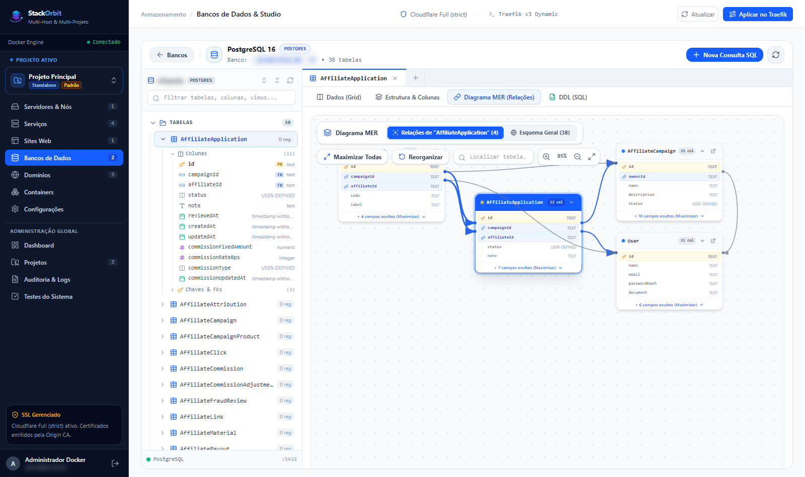
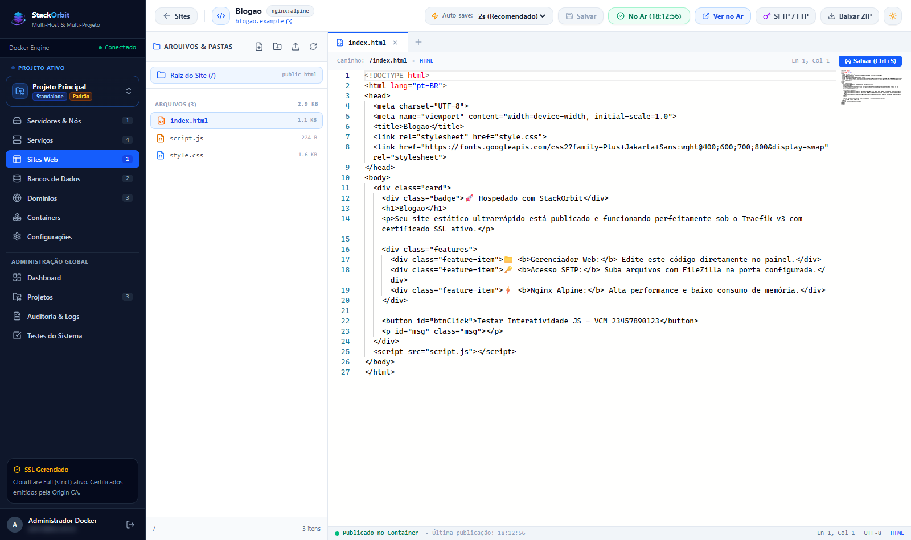
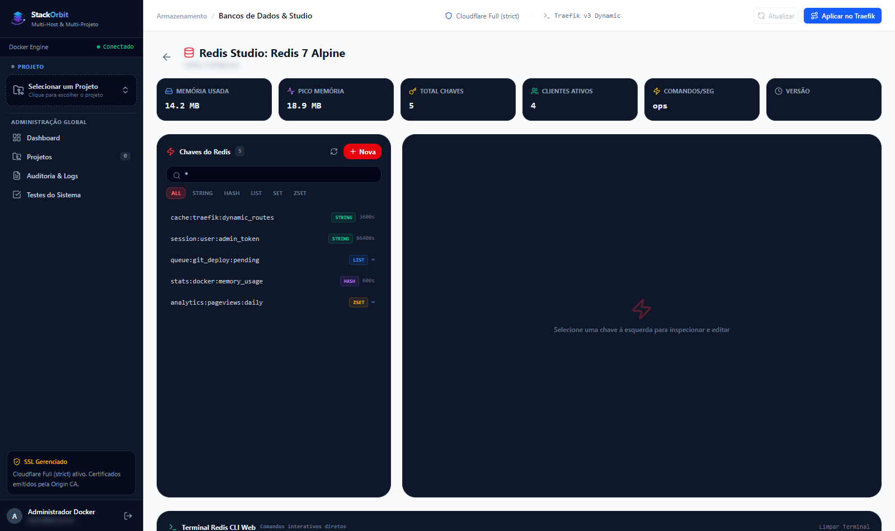

# StackOrbit

StackOrbit is a self-hosted PaaS for deploying and operating Docker applications behind Traefik. It combines dynamic domain routing, TLS, Git-based deployments, monitoring, audit logs, and multi-host load balancing in one interface.

## Who is it for?

- Developers deploying applications to their own VPS;
- small teams that need a lightweight internal PaaS;
- DevOps teams managing Docker hosts and domains;
- agencies and infrastructure providers operating multiple customer environments.

## Quick start

On a Linux server with Docker installed:

```bash
curl -fsSL https://raw.githubusercontent.com/stackline-saas/stackorbit/master/scripts/install.sh | bash
```

For a manual installation, see the main README and `docker-compose.prod.yml`.

## Screenshots & Interface

### Dashboard & Monitoring


### Database Studio - DBeaver-style Object Explorer


### Database Studio - Interactive Relational ER Diagram


### Sites Web & Integrated Monaco Web IDE


### Redis Studio & Web CLI Terminal


## Main capabilities

- Dynamic domain and subdomain routing through Traefik v3;
- Cloudflare Origin CA / Full (Strict) TLS support;
- GitHub and GitLab webhook deployments;
- **Sites Manager & Web IDE**: in-browser code editor powered by Monaco, direct file management, and instant publish to dedicated Nginx containers;
- **Database Studio**: hierarchical object explorer for PostgreSQL/MySQL, data grid inspector, and interactive field-anchored ER diagram;
- **Redis Studio**: live memory telemetry, key browser with TTL support, and web-based interactive CLI terminal;
- local and remote Docker hosts connected through SSH;
- health checks, failover, and weighted load balancing;
- live resource and container-log monitoring;
- administrator audit logs;
- one-click update support.

## Contributing and security

Read [CONTRIBUTING.md](../CONTRIBUTING.md), [SECURITY.md](../SECURITY.md), and [CODE_OF_CONDUCT.md](../CODE_OF_CONDUCT.md).

## Sponsorship

Funding helps maintain releases, improve security, expand documentation, and support integrations. Add the project's GitHub Sponsors URL here once it is enabled.
