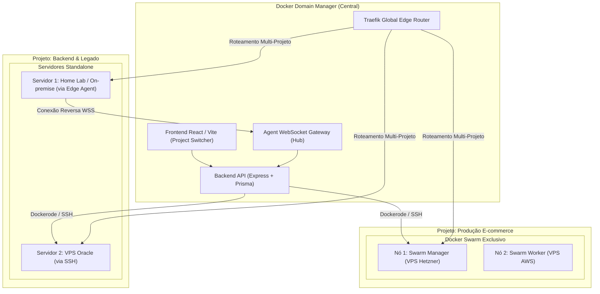

# 🏗️ Especificação de Arquitetura: Multi-Projeto, Dockers Remotos & Roteamento Global

## 1. Visão Geral e Objetivos

Evoluir o **Docker Domain Manager** de um gerenciador mono-host para uma **plataforma completa de orquestração multi-projetos e multi-servidores**.

O sistema permitirá:
1. **Hierarquia por Projetos:** Cada projeto funciona como um ambiente isolado com seus próprios servidores (Docker Hosts) e serviços.
2. **Suporte a Cluster Swarm por Projeto:** Um projeto pode operar como nós independentes (Standalone) ou como um cluster Docker Swarm exclusivo (Manager + Workers) com rede overlay e failover.
3. **Conexão Universal de Servidores (Qualquer Lugar):**
   - **SSH Direto (VPS / Nuvem Pública):** Para servidores com IP público.
   - **TCP / TLS (mTLS):** Para servidores em redes internas ou VPN.
   - **Edge Agent Reverso (Qualquer lugar / Atrás de CGNAT/Firewall):** Um container leve que se conecta via WebSocket seguro de dentro para fora, dispensando IP público e abertura de portas.
4. **Balanceamento de Carga Global de Domínios entre Projetos:** O Traefik central poderá rotear e balancear um mesmo domínio (ex: `app.exemplo.com`) entre serviços rodando em projetos e servidores distintos (Multi-Cloud / Multi-Region).
5. **Interface com Contexto de Projeto e Etiquetas:** Seletor de projeto no topo e listagem de serviços com badges/etiquetas identificando em qual servidor remoto cada container está alocado.

---

## 2. Diagrama de Arquitetura



---

## 3. Modelo de Dados (Prisma Schema)

```prisma
enum DockerHostType {
  LOCAL_SOCKET
  SSH
  TCP_TLS
  EDGE_AGENT
}

enum DockerHostStatus {
  ONLINE
  OFFLINE
  CONNECTING
  ERROR
}

enum ProjectType {
  STANDALONE
  SWARM
}

model Project {
  id                    String       @id @default(cuid())
  name                  String       @unique
  slug                  String       @unique
  description           String?
  type                  ProjectType  @default(STANDALONE)
  swarmJoinTokenManager String?
  swarmJoinTokenWorker  String?
  createdAt             DateTime     @default(now())
  updatedAt             DateTime     @updatedAt
  hosts                 DockerHost[]
  services              Service[]

  @@map("projects")
}

model DockerHost {
  id             String           @id @default(cuid())
  name           String
  projectId      String
  project        Project          @relation(fields: [projectId], references: [id], onDelete: Cascade)
  type           DockerHostType   @default(SSH)
  status         DockerHostStatus @default(OFFLINE)
  endpointUrl    String           // Ex: "ssh://user@203.0.113.10:22" ou "wss://agent"
  sshKey         String?          @db.Text
  tlsCert        String?          @db.Text
  tlsKey         String?          @db.Text
  tlsCa          String?          @db.Text
  agentToken     String?          @unique
  isSwarmManager Boolean          @default(false)
  swarmNodeId    String?
  cpuUsage       Float?
  memUsage       Float?
  dockerVersion  String?
  osInfo         String?
  lastPingAt     DateTime?
  createdAt      DateTime         @default(now())
  updatedAt      DateTime         @updatedAt
  services       Service[]

  @@index([projectId])
  @@map("docker_hosts")
}
```

---

## 4. Métodos de Conexão com Servidores

| Método | Casos de Uso | Requisitos de Rede | Como Funciona |
| :--- | :--- | :--- | :--- |
| **SSH Direto** | VPSs em nuvem (Hetzner, AWS, DO, Oracle) | IP público e porta 22 | O backend usa `docker system dial-stdio` sobre túnel SSH com chave privada |
| **TCP / TLS** | Redes locais corporativas ou VPN WireGuard | Porta Docker 2376 aberta | Conexão mTLS com certificados cliente/servidor |
| **Edge Agent Reverso** | Servidores caseiros, Home Lab, atrás de CGNAT/NAT | Apenas saída para a internet (HTTPS) | Um container leve (`dd-agent`) conecta de dentro para fora via WebSocket seguro |

---

## 5. Roteamento e Balanceamento no Traefik

O Traefik central roda como Gateway Principal:
1. **Roteamento Simples:** `Host(app.exemplo.com)` encaminhado para o IP e porta do container no host específico.
2. **Balanceamento Cross-Project:**
   ```yaml
   http:
     routers:
       router-app-exemplo-com:
         rule: Host(`app.exemplo.com`)
         service: service-app-exemplo-com
     services:
       service-app-exemplo-com:
         loadBalancer:
           servers:
             - url: http://vps-projeto-a.ip:3000   # Nó do Projeto A
             - url: http://vps-projeto-b.ip:3000   # Nó do Projeto B
   ```
