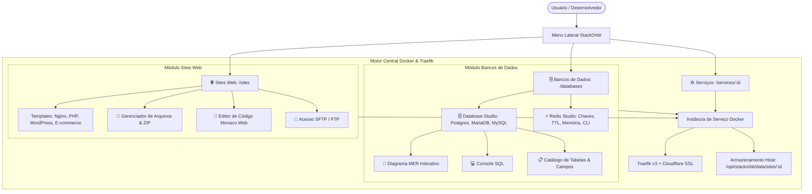
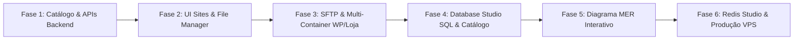

# Plano de Desenvolvimento: Sites Web & Hub de Bancos de Dados (Database Studio, MER & Redis Studio)

> **Documento:** `plan/site_and_db_plan.md`  
> **Status:** Proposto / Em Planejamento  
> **Módulos:** Sites Web (`/sites`) e Bancos de Dados (`/databases`)  
> **Integração:** Totalmente sincronizado com o motor de Serviços (`/services`) e Traefik Proxy.

---

## 1. Visão Geral e Arquitetura

O objetivo é transformar o StackOrbit em uma plataforma de nuvem completa para desenvolvedores e webmasters, fornecendo duas novas verticais de primeira classe:

1. **Sites Web (`/sites`)**: Focado na criação e gestão rápida de sites estáticos, PHP, WordPress e lojas virtuais (WooCommerce/PrestaShop). Cada site conta com **Gerenciador de Arquivos Web nativo**, **Editor de Código Monaco/VS Code**, **acesso SFTP/FTP** e templates que sobem a aplicação e o banco MariaDB automaticamente.
2. **Bancos de Dados (`/databases`)**: Hub centralizado de todos os bancos do projeto (PostgreSQL, MariaDB, MySQL, Redis), com um **Database Studio Nativo** capaz de inspecionar tabelas, campos, tipos, gerar um **Diagrama MER interativo**, rodar queries no **Console SQL** e gerenciar chaves/TTL/CLI no **Redis Studio**.

---

## 2. Especificação do Módulo de Sites Web

### 2.1 Templates com Provisionamento Automático
Cada site selecionado cria um serviço com diretório dedicado no host (`/opt/stackorbit/data/sites/<id>`):

| Template | Containers Provisionados | Porta Web | Banco de Dados | Arquivos Iniciais Gerados |
| :--- | :--- | :--- | :--- | :--- |
| **Site Estático** | 1x `nginx:alpine` | `80` | Nenhum (estático) | `index.html` (Landing moderna responsiva), `style.css`, `script.js` |
| **PHP Dinâmico** | 1x `php:8.2-apache` | `80` | Opcional (PDO/SQLite) | `index.php` (Página de boas-vindas com dados do PHP e StackOrbit) |
| **WordPress CMS** | 2x Containers: • `wordpress:php8.2-apache` • `mariadb:11` | `80` | **MariaDB criado e conectado automaticamente** | Core completo do WordPress inicializado com credenciais pré-configuradas |
| **E-commerce (PrestaShop / WooCommerce)** | 2x Containers: • Aplicação E-commerce • `mariadb:11` | `80` | **MariaDB criado e conectado automaticamente** | Estrutura de catálogo de produtos e loja virtual pronta |

### 2.2 Gerenciador de Arquivos Web (File Explorer)
- Navegação visual de pastas com breadcrumb dinâmico (`/`, `/wp-content/`, `/css/`, etc.).
- **Upload Drag-and-Drop**: Arrastar arquivos ou pastas diretamente para o navegador.
- **Suporte a ZIP**: Upload de `.zip` com botão **"Descompactar no Servidor"** e opção **"Baixar Seleção como ZIP"**.
- Ações: Criar Arquivo, Criar Pasta, Renomear, Duplicar, Excluir, Pré-visualizar Imagens (`.png`, `.jpg`, `.svg`).

### 2.3 Editor de Código Monaco / VS Code Engine
- Editor integrado com syntax highlighting para HTML, CSS, JavaScript, TypeScript, PHP, JSON, Markdown, YAML, SQL, `.env`, `.htaccess`.
- Atalho `Ctrl+S` para salvar com feedback visual imediato.
- Numeração de linha, busca e substituição (`Ctrl+F`), indentação automática e modo tela cheia.
- Botão sob demanda: **"Iniciar VS Code Web"** (`codercom/code-server`) para ambiente de IDE completo com terminal integrado.

### 2.4 Acesso SFTP / FTP & SSH
- Geração de credenciais seguras por site:
  - **Host**: IP ou domínio do servidor (ex: `169.58.122.148`).
  - **Porta SFTP**: Porta dedicada (ex: `2222` ou mapeada).
  - **Usuário**: `site_<slug>`
  - **Senha**: Senha forte com botão de revelar/copiar e redefinir.
  - **Caminho Remoto**: `/` (mapeado para a raiz do site).
- Botão de 1-clique para string de conexão compatível com FileZilla, Cyberduck e WinSCP.
- Acesso ao Terminal Web bash/sh interativo do container.

---

## 3. Especificação do Módulo de Bancos de Dados

### 3.1 Central de Bancos de Dados (`/databases`)
- Detecta todas as instâncias de bancos no projeto ativo:
  - PostgreSQL 15 / 16
  - MariaDB 10 / 11 / MySQL 8
  - Redis 7
  - Bancos criados para WordPress ou E-commerce
- Métricas em tempo real: status de execução, consumo de CPU e RAM, porta interna e host.
- Ações rápidas: Copiar Connection String, Criar Backup/Dump, Reiniciar, Parar.
- Botão **"+ Novo Banco de Dados"** para provisionar instâncias em 1 clique.

### 3.2 Database Studio (PostgreSQL / MariaDB / MySQL)

#### A. Explorador de Catálogo & Schema
- Árvore de navegação com:
  - **Tabelas**: nome, total estimado de linhas e tamanho no disco.
  - **Views**: visualizações salvas.
  - **Funções / Stored Procedures**: rotinas e assinaturas de parâmetros.
  - **Triggers**: gatilhos ativos por tabela.
- Ao clicar em uma tabela:
  - Exibe a lista completa de **colunas/campos**:
    - Nome da coluna
    - Tipo de dado nativo (`varchar`, `integer`, `timestamp`, `uuid`, `jsonb`, etc.)
    - Permite Nulo? (Nullable)
    - Chave Primária (PK 🔑) ou Estrangeira (FK 🔗)
    - Valor padrão (Default)
  - Aba de **Índices** (B-Tree, Hash, Unique) e **Foreign Keys** com tabela e coluna de referência.

#### B. Visualizador de Dados (Data Grid)
- Visualização tabular dos registros da tabela com paginação (50, 100, 200 linhas).
- Ordenação por coluna (clique no cabeçalho) e filtro rápido de pesquisa.

#### C. Diagrama MER Interativo (Entity-Relationship)
- Geração visual automática da modelagem do banco a partir do catálogo.
- Cada tabela é representada por um cartão visual contendo seu nome e campos com ícone de chave 🔑.
- Linhas curvas/retas conectam as chaves estrangeiras (FK) aos campos das tabelas relacionadas.
- Controles interativos:
  - Arrastar e soltar tabelas para organizar o layout.
  - Zoom in / Zoom out e Pan (arrastar tela).
  - Botão de "Auto-organizar Layout" e "Exportar Diagrama como Imagem".

#### D. Console SQL (Query Editor)
- Editor de código SQL com destaque de sintaxe e autocompletar.
- Atalho `Ctrl+Enter` para executar consultas.
- Exibição dos resultados em tabela paginada com tempo de resposta em milissegundos.

### 3.3 Redis Studio (Cache & Filas)
- **Key Browser**: Busca por padrões com glob (`*`, `bull:*`, `session:*`, `cache:*`).
- **Filtragem por Tipo**: `STRING`, `HASH`, `LIST`, `SET`, `ZSET`.
- **Inspetor de Valores**:
  - `STRING`: Formatação de texto e JSON com highlight.
  - `HASH`: Tabela de campos e valores com adição e remoção inline.
  - `LIST` / `SET`: Itens ordenados com paginação.
- **Gerenciador de TTL**: Exibição do tempo restante de vida da chave e botão para alterar ou persistir.
- **Métricas do Redis**: Consumo de memória (`used_memory_human`), clientes conectados, comandos por segundo e taxa de acerto no cache.
- **Terminal Redis CLI Web**: Linha de comando para executar comandos diretos do Redis (`INFO`, `GET`, `SET`, `HGETALL`, `TTL`, `DEL`).

---

## 4. Fases de Desenvolvimento

### 📋 Fase 1: Catálogo de Templates e APIs de Arquivos (Backend)
- [ ] Registrar novos templates no `@stackorbit/shared`: Site Estático (Nginx), PHP Dinâmico, WordPress (com MariaDB) e E-commerce.
- [ ] Implementar serviço de arquivos no backend (`apps/backend/src/services/site-files.service.ts`):
  - Listagem de diretórios com estatísticas (tamanho, permissões, data).
  - Leitura e gravação de arquivos de texto (para o editor).
  - Upload multipart de arquivos (via multer/busboy).
  - Descompactação de arquivos `.zip` e download de diretórios compactados.
  - Criação de arquivos/pastas, renomeação e exclusão.
- [ ] Criar rotas `/api/sites` e `/api/sites/:id/files/*` em `apps/backend/src/routes/sites.routes.ts`.

### 📋 Fase 2: Interface de Sites Web e Gerenciador de Arquivos (Frontend)
- [ ] Adicionar item **"Sites Web"** no menu principal (`Sidebar.tsx`).
- [ ] Criar a visão `/sites` (`SitesView.tsx`) com cards visuais dos sites, status, domínios e ações rápidas.
- [ ] Criar modal de criação de sites (`CreateSiteModal.tsx`) com seleção de template, domínio e senha SFTP.
- [ ] Criar o componente **Gerenciador de Arquivos Web** (`SiteFileManager.tsx`):
  - Explorador de pastas com breadcrumb e árvore.
  - Drag-and-drop de upload e botão de extrair ZIP.
  - Download individual e download de pasta em ZIP.
- [ ] Criar o componente **Editor de Código Web** com engine Monaco/Code:
  - Syntax highlighting para HTML, CSS, JS, PHP, JSON, SQL e `.env`.
  - Atalhos (`Ctrl+S`), numeração de linhas e modo tela cheia.
- [ ] Integrar abas de **Arquivos & Web IDE** tanto no detalhe do site quanto no detalhe de serviços (`ServiceDetailView.tsx`).

### 📋 Fase 3: Acesso SFTP e Provisionamento Multi-Container
- [ ] Configurar container de serviço SFTP (OpenSSH/Alpine ou `atmoz/sftp`) com montagem do volume `/opt/stackorbit/data/sites/<id>`.
- [ ] Exibir cartão com dados de conexão SFTP (Host, Porta, Usuário, Senha revelável, string para FileZilla).
- [ ] Implementar provisionamento multi-container para **WordPress** e **E-commerce**:
  - Container Web + Container MariaDB conectados na rede interna `proxy-net`.
  - Injeção automática das variáveis de conexão do banco.
  - Agrupamento na aba *Containers da Stack*.

### 📋 Fase 4: Hub de Bancos de Dados e Database Studio SQL
- [ ] Adicionar item **"Bancos de Dados"** no menu principal (`Sidebar.tsx`).
- [ ] Criar a visão `/databases` (`DatabasesView.tsx`) listando todos os bancos do projeto (Postgres, MariaDB, Redis).
- [ ] Implementar rotas de inspeção no backend (`apps/backend/src/routes/databases.routes.ts`):
  - Extração de tabelas, colunas, tipos, PKs, FKs, views e funções via queries do `information_schema` do Postgres e MariaDB/MySQL.
  - Endpoint de consulta de dados paginados (`/api/databases/:id/table-data`).
  - Endpoint seguro de execução de queries SQL (`/api/databases/:id/query`).
- [ ] Criar a tela **Database Studio** (`DatabaseStudioView.tsx`):
  - Navegador de catálogo de tabelas, views e rotinas.
  - Tabela detalhada de colunas e tipos de dados.
  - Data Grid paginado para visualizar registros.
  - Console SQL interativo com histórico e atalho `Ctrl+Enter`.

### 📋 Fase 5: Diagrama MER Interativo
- [ ] Criar componente visual de modelagem relacional (`DatabaseDiagramMER.tsx`):
  - Renderização das tabelas como caixas arrastáveis com campos e ícone 🔑 para PKs.
  - Traçado de linhas visuais conectando as Foreign Keys às chaves primárias.
  - Ferramentas de zoom, pan, centralização e auto-layout.
  - Exportação do diagrama em imagem PNG ou SVG.

### 📋 Fase 6: Redis Studio, Integração Final & Deploy VPS
- [ ] Implementar rotas e driver Redis no backend (`ioredis`):
  - Listagem de chaves por padrão (`SCAN`), tipo, TTL e valor.
  - Criação, edição e exclusão de chaves.
  - Execução de comandos CLI Redis.
- [ ] Criar a interface **Redis Studio** (`RedisStudioView.tsx`):
  - Key Browser com badge visual de tipo (`STRING`, `HASH`, `LIST`, `SET`, `ZSET`).
  - Inspetor e editor de campos/valores com conversão JSON.
  - Painel de métricas de memória em tempo real.
  - Terminal interativo Web Redis CLI.
- [ ] Testes de compilação em todo o monorepo (`pnpm build`).
- [ ] Deploy na VPS (`169.58.122.148:8088`), criação de tag git e validação completa em produção.

---

## 5. Estratégia de Verificação e Testes

1. **Sites Web**:
   - Criar 1 site estático e 1 site WordPress.
   - Navegar pelos arquivos no Gerenciador de Arquivos Web, fazer upload de um `.zip`, descompactar no servidor e validar via navegador.
   - Editar `index.html` via Monaco Editor, salvar com `Ctrl+S` e checar atualização instantânea pelo domínio público.
   - Conectar via cliente SFTP (FileZilla) utilizando as credenciais geradas.
2. **Bancos de Dados**:
   - Acessar `/databases`, abrir o **Database Studio** de uma instância PostgreSQL e MariaDB.
   - Validar se todas as tabelas e campos com tipos são carregados corretamente.
   - Acessar a aba **Diagrama MER** e conferir os relacionamentos entre tabelas conectadas por FK.
   - Executar consultas `SELECT` no console SQL.
   - Acessar o **Redis Studio**, criar chaves de teste, inspecionar TTL e rodar comandos no terminal CLI.
